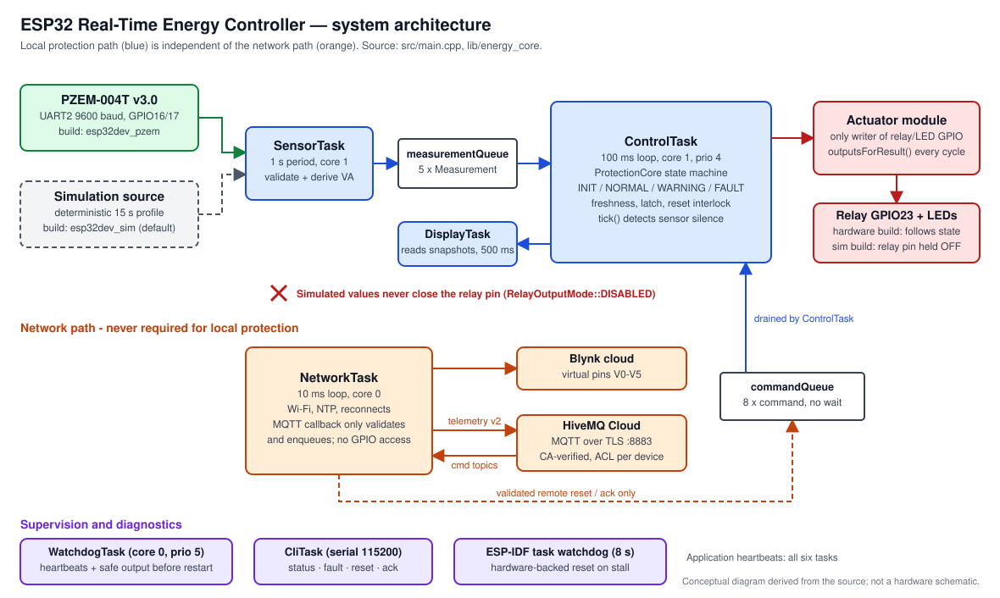
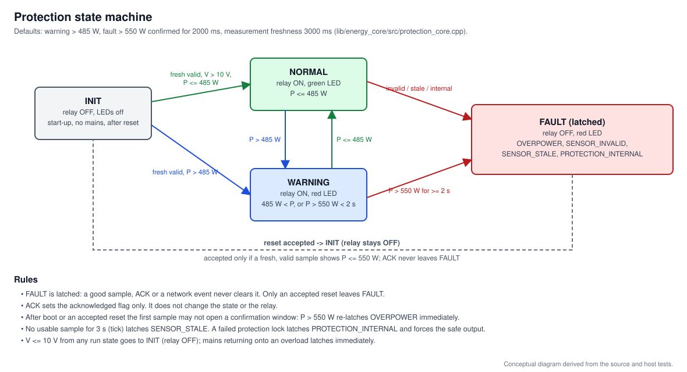
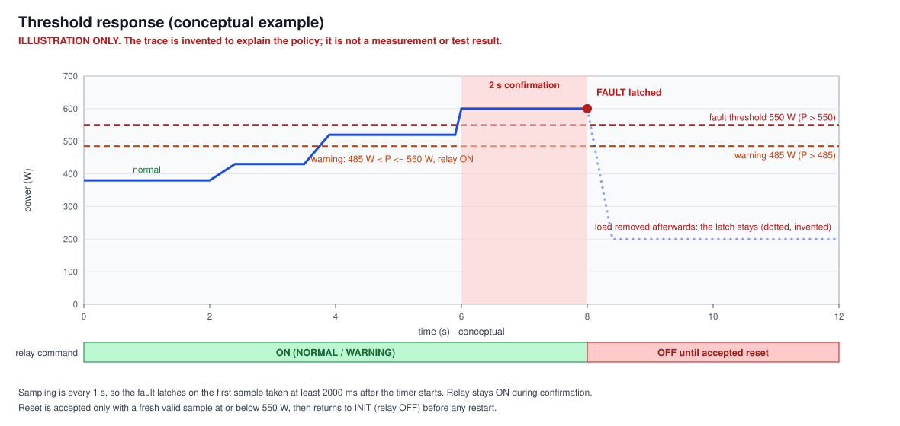
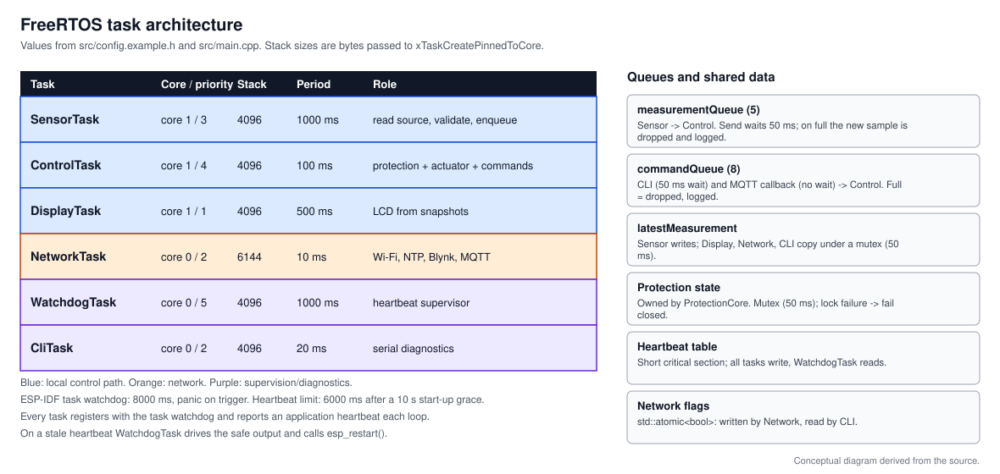
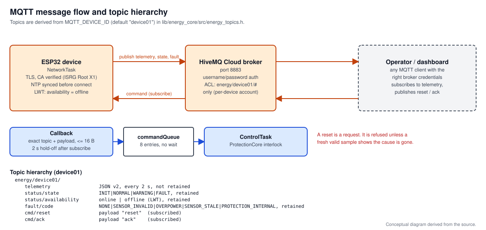
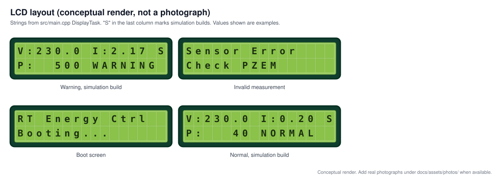

# ESP32 Real-Time Energy Controller

ESP32 firmware that measures AC power with a PZEM-004T v3.0 (or a deterministic
simulation), applies a time-confirmed overpower policy, commands a relay
fail-safe, and reports over Blynk and MQTT/TLS - while keeping the local
protection path independent of the network.


> **Status: educational prototype.** Not certified, not a substitute for a
> fuse/breaker/RCD, not production-qualified. Thresholds are project settings,
> not safety ratings. Mains electricity can kill: read
> [docs/safety-and-limitations.md](docs/safety-and-limitations.md) before
> connecting anything beyond the ESP32 and USB.



## Highlights

- Six FreeRTOS tasks; protection path never waits on Wi-Fi, Blynk, MQTT or NTP
- Hardware-independent decision core (`lib/energy_core`) with **87 host unit
  tests** (threshold boundaries, latch, reset interlock, rollover, fail-closed
  paths)
- **Simulation builds cannot drive the relay pin** (separate PlatformIO
  environment, compile-time guards)
- Latched faults; `ack` and `reset` are different; reset is refused while the
  cause is present and re-arms the core so the load is never energised for a
  confirmation window
- Stale/invalid measurements fault; protection lock failure fails closed
- MQTT over TLS with CA verification (no `setInsecure()`), narrow device-scoped
  topics, bounded exact-match command handling, JSON telemetry schema v2
- Task watchdog plus application heartbeat supervisor; serial diagnostics CLI

## Status summary

| Aspect | Status |
|---|---|
| Implemented | Yes (see highlights) |
| Host unit tests | 87 tests, `make test` - decision logic only |
| ESP32 firmware build | CI workflow builds `esp32dev_sim` and `esp32dev_pzem`; it has **not been run yet** and `pio run` was not possible in the environment where this revision was prepared (see [CHANGELOG](CHANGELOG.md)) |
| Author-reported hardware validation | PZEM readings compared with a trusted meter, relay opening on overload, CLI/MQTT reset/ack, extended run - **no committed records** |
| Independently reproducible hardware evidence | None committed yet |
| Known gaps | No relay feedback, fault latch not persisted, relay safe-state during reset is hardware-dependent, no license, toolchain not pinned ([roadmap](docs/roadmap.md)) |

## Safety design in one picture

| Condition | State | Relay command |
|---|---|---|
| Boot, no mains (V <= 10 V), after accepted reset | INIT | OFF |
| P <= 485 W | NORMAL | ON |
| 485 W < P <= 550 W | WARNING | ON |
| P > 550 W for >= 2 s | FAULT `OVERPOWER` (latched) | OFF |
| Invalid sample | FAULT `SENSOR_INVALID` (latched) | OFF |
| No usable sample for 3 s | FAULT `SENSOR_STALE` (latched) | OFF |
| Protection could not run | FAULT `PROTECTION_INTERNAL` (latched) | OFF |



Details and the reset interlock: [docs/fault-management.md](docs/fault-management.md).
The relay state shown anywhere is the **commanded** state; there is no contact
feedback.



## Quick start (simulation, no hardware risk)

```bash
pip install platformio
cp src/config.example.h src/config.h      # edit Wi-Fi/MQTT/Blynk placeholders
pio run -e esp32dev_sim                   # default environment
pio run -e esp32dev_sim -t upload
pio device monitor                        # 115200 baud
make test                                 # host unit tests, no ESP32 needed
```

| Environment | Source | Relay GPIO |
|---|---|---|
| `esp32dev_sim` (default) | deterministic simulation | held at OFF level, never ON |
| `esp32dev_pzem` | PZEM-004T v3.0 | follows the protection state |

The source is selected **only** by the environment (`src/build_mode.h`), never
by `config.h`. It is shown in the boot banner, `status`/`version`, telemetry
(`source`, `simulated`) and as `S` in the last LCD column.

For hardware: read [docs/hardware-and-wiring.md](docs/hardware-and-wiring.md),
complete the no-load verification checklist, and only then
`pio run -e esp32dev_pzem -t upload`.

## Hardware

| Function | GPIO |
|---|---:|
| UART2 RX (ESP32) <- PZEM TX | 16 |
| UART2 TX (ESP32) -> PZEM RX | 17 |
| Normal LED / Alert LED | 18 / 19 |
| Relay control (active-low default) | 23 |
| 16x2 I2C LCD (0x27) | default SDA/SCL |

Relay polarity, contact rating and a pull resistor holding the driver OFF
during reset must be verified for **your** parts. PZEM UART 9600 baud.

## Architecture



| Task | Core / prio | Period |
|---|---|---|
| SensorTask | 1 / 3 | 1 s |
| ControlTask | 1 / 4 | 100 ms |
| DisplayTask | 1 / 1 | 500 ms |
| NetworkTask | 0 / 2 | 10 ms |
| WatchdogTask | 0 / 5 | 1 s |
| CliTask | 0 / 2 | 20 ms |

Queues, ownership and failure behaviour: [docs/architecture.md](docs/architecture.md).
Measurement validation: [docs/measurement-pipeline.md](docs/measurement-pipeline.md).

## MQTT

Topics derive from `MQTT_DEVICE_ID` (default `device01`):

| Topic | Direction |
|---|---|
| `energy/device01/telemetry` | publish, JSON v2 |
| `energy/device01/status/state`, `.../status/availability`, `.../fault/code` | publish, retained |
| `energy/device01/cmd/reset` (`reset`), `.../cmd/ack` (`ack`) | subscribe |

Synthetic example (simulation build, not a measurement):

```json
{"schema_version":2,"device_id":"device01","firmware_version":"1.3.0",
 "source":"SIMULATION","simulated":true,"uptime_ms":123456,"valid":true,
 "measurement_status":"OK","measurement_age_ms":40,"voltage":230.00,
 "current":2.170,"power":500.00,"energy":0.000,"apparent_power":499.10,
 "power_factor":1.000,"state":"WARNING","fault":"NONE","fault_active":false,
 "fault_acknowledged":false,"last_reset_result":"NONE",
 "relay_commanded_on":true,"relay_output_enabled":false}
```



Broker ACLs, retained-message caveat and command validation:
[docs/mqtt-protocol.md](docs/mqtt-protocol.md). Blynk uses virtual pins
V0-V5 (voltage, current, power, energy, apparent power, power factor); the
dashboard itself lives in your Blynk account and is not part of this repo.

## Serial diagnostics (115200 baud)

`help`, `status`, `measure`, `fault`, `watchdog`, `tasks`, `uptime`, `version`,
`ack`, `reset`. `reset` prints the interlock result (`ACCEPTED` or
`REJECTED_*`).

## LCD



*Conceptual render, not a photograph.*

## Security

`src/config.h` (credentials) is git-ignored; `config.example.h` has
placeholders only. TLS validates the broker against the ISRG Root X1 CA.
Use per-device broker accounts with narrow ACLs and no retained command
topics. See [docs/security-and-privacy.md](docs/security-and-privacy.md).

## Testing and CI

- `make test` - host unit tests (`g++ -Wall -Wextra -Werror`).
- `.github/workflows/ci.yml` (not yet executed) - host tests, both firmware environments with a
  placeholder `config.h`, link check and secret scan. No credentials, network
  services or hardware are needed.
- Procedure and evidence levels: [docs/test-procedure.md](docs/test-procedure.md).

## Documentation

[Architecture](docs/architecture.md) ·
[Measurement](docs/measurement-pipeline.md) ·
[Fault management](docs/fault-management.md) ·
[MQTT](docs/mqtt-protocol.md) ·
[Hardware & wiring](docs/hardware-and-wiring.md) ·
[Safety & limitations](docs/safety-and-limitations.md) ·
[Security](docs/security-and-privacy.md) ·
[Testing](docs/test-procedure.md) ·
[Troubleshooting](docs/troubleshooting.md) ·
[Traceability](docs/requirements-traceability.md) ·
[Engineering audit](docs/engineering-audit.md) ·
[Release checklist](docs/release-checklist.md) ·
[Roadmap](docs/roadmap.md)

## Gallery

No hardware photographs are committed yet; the images above are original
diagrams and a conceptual LCD render. Real bench photos will be added under
`docs/assets/photos/` with accurate captions.

## Known limitations

No relay contact feedback; fault latch is RAM-only; relay behaviour while the
ESP32 resets depends on external hardware; thresholds and measurement
plausibility limits are unvalidated project settings; toolchain versions are
not pinned; no license file. See [docs/safety-and-limitations.md](docs/safety-and-limitations.md).

## Roadmap

See [docs/roadmap.md](docs/roadmap.md).

## License and author

Author: yash-mehta13. **No license file is present**, so reuse terms are
undefined until the author chooses one.

Contributing: [CONTRIBUTING.md](CONTRIBUTING.md) · Security policy:
[SECURITY.md](SECURITY.md) · Changes: [CHANGELOG.md](CHANGELOG.md)
