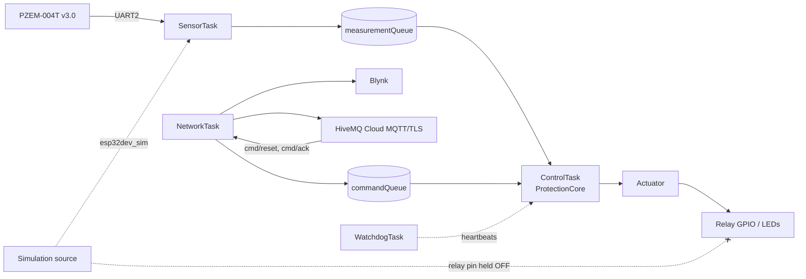

# System Architecture


The firmware is a set of FreeRTOS tasks around a hardware-independent core
library. Everything that decides whether the relay may be ON lives in
`lib/energy_core` and is unit-tested on a host machine; `src/` contains thin
adapters to the ESP32 Arduino runtime.

## 1. Modules

| Module | Location | Responsibility |
|---|---|---|
| `build_mode.h` | `src/` | The only place the measurement source and relay output mode are decided (from PlatformIO build flags). |
| `measurement_core` | `lib/energy_core` | Validation, derived values, simulation profile, freshness. Pure. |
| `protection_core` | `lib/energy_core` | `ProtectionCore` state machine, latch, reset interlock. Pure, time injected. |
| `actuator_policy` | `lib/energy_core` | State -> outputs, build-mode gating, polarity mapping. Pure. |
| `remote_command` | `lib/energy_core` | Exact MQTT command validation and hold-off. Pure. |
| `energy_topics.h` | `lib/energy_core` | Topic names derived from `MQTT_DEVICE_ID`. |
| `telemetry_json` | `lib/energy_core` | Bounded, escaped JSON serialiser. Pure. |
| `heartbeat_monitor` | `lib/energy_core` | Heartbeat table and timeout logic. Pure. |
| `measurement.cpp` | `src/` | PZEM driver (hardware build) or simulation source. |
| `protection.cpp` | `src/` | Mutex-guarded wrapper around `ProtectionCore`, fail-closed on lock failure. |
| `actuator.cpp` | `src/` | **Only** writer of relay and LED GPIOs. |
| `mqtt_manager.cpp` | `src/` | TLS client, callback (validate and enqueue only), publishing. |
| `watchdog_manager.cpp` | `src/` | Task-watchdog registration, heartbeat storage. |
| `diagnostics.cpp` | `src/` | Serial CLI output. |
| `main.cpp` | `src/` | Task creation and orchestration. |

## 2. Tasks


| Task | Core | Priority | Period | Stack (B) | Responsibility |
|---|---:|---:|---|---:|---|
| SensorTask | 1 | 3 | 1000 ms | 4096 | Read source, validate, enqueue, update latest copy |
| ControlTask | 1 | 4 | 100 ms | 4096 | `protectionUpdate/Tick`, actuator, reset/ack |
| DisplayTask | 1 | 1 | 500 ms | 4096 | LCD |
| NetworkTask | 0 | 2 | 10 ms | 6144 | Wi-Fi, NTP, Blynk, MQTT |
| WatchdogTask | 0 | 5 | 1000 ms | 4096 | Heartbeat supervision |
| CliTask | 0 | 2 | 20 ms | 4096 | Serial diagnostics |

Core, priority and period values come from `src/config.example.h`. They are a
design starting point and have not been profiled under load on hardware.

## 3. Queues, ownership and overflow

| Object | Producer -> consumer | Capacity | Overflow policy |
|---|---|---:|---|
| `measurementQueue` | SensorTask -> ControlTask | 5 | Send waits 50 ms, then the new sample is dropped and logged. Staleness is detected independently by `tick()`. |
| `commandQueue` | CliTask (50 ms wait), MQTT callback (no wait) -> ControlTask | 8 | Dropped and logged. Reset/ack are idempotent requests the operator can resend. |
| `latestMeasurement` | SensorTask writes; Display/Network/Cli read | 1 | Mutex, 50 ms. A failed copy yields a `NOT_INITIALIZED` (invalid) sample, never zeros marked valid. |
| Protection state | ControlTask writes; others read snapshots | 1 | Mutex, 50 ms. Failure fails closed (see below). |
| Heartbeat table | all write, WatchdogTask reads | 6 slots | Short critical section. |
| Network flags | NetworkTask writes, CliTask reads | - | `std::atomic<bool>`. |

State ownership: `ProtectionCore` is the single owner of protection state;
`actuator.cpp` is the single owner of relay/LED GPIOs. MQTT callbacks never
touch either.

## 4. Local protection is independent of the network

```text
Source -> SensorTask -> measurementQueue -> ControlTask -> ProtectionCore -> Actuator
```

Nothing on this path waits on Wi-Fi, Blynk, MQTT or NTP. NetworkTask only
reads copies. A cloud outage cannot delay a fault. The converse also holds:
a remote command can only *request* a reset and is judged by the same local
interlock as a serial `reset`.

## 5. Failure behaviour

| Failure | Behaviour |
|---|---|
| Protection mutex cannot be taken | `ProtectionCore::lockFailureResult()`: state FAULT, `PROTECTION_INTERNAL`, `synchronizationFailed`. The actuator is driven on every result, so the relay goes OFF even though change flags are irrelevant. The next call that obtains the lock latches the fault. |
| No usable sample for 3 s | `tick()` latches `SENSOR_STALE`. |
| Invalid sample | Latches `SENSOR_INVALID`. |
| ControlTask or another task stalls | Heartbeat limit (6 s after 10 s grace) -> safe output, then `esp_restart()`; the ESP-IDF task watchdog (8 s) is the second line. |
| Relay GPIO readback differs | Counted (`actuatorReadbackMismatches`), rewritten once, visible in `status`. This checks the pin, not the contacts. |
| Firmware reset / unpowered ESP32 | Pin state is hardware-defined: see docs/hardware-and-wiring.md. |

## 6. Mermaid overview


