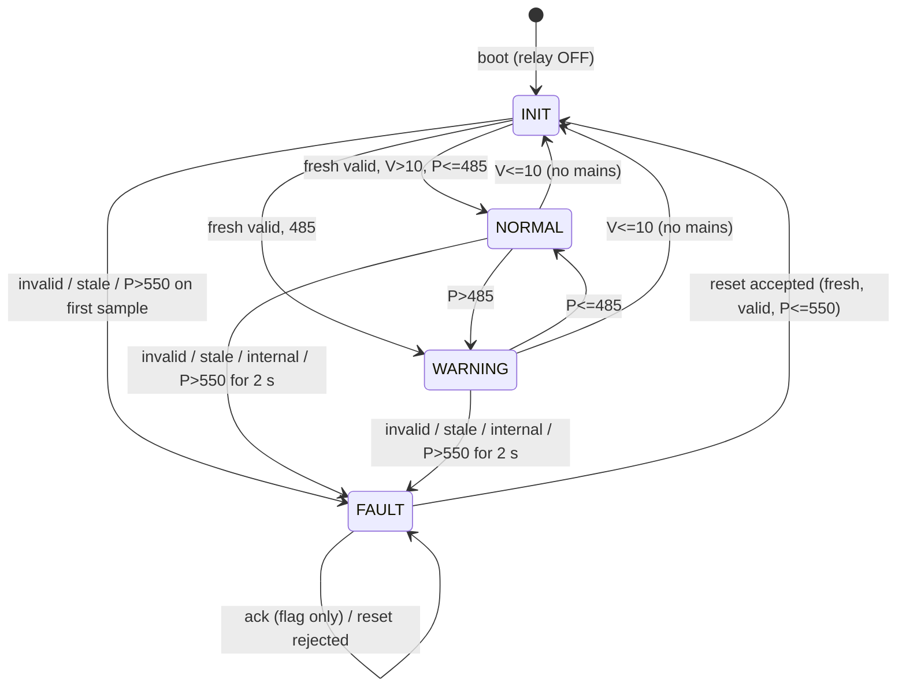

# Fault Management

Implemented in `lib/energy_core/src/protection_core.cpp` (`ProtectionCore`) and
exercised by `test/native/test_protection.cpp`. The thresholds are **project
configuration values** (`src/config.example.h`), not validated safety ratings:
they must be matched to the real load, relay, wiring and test conditions.

## 1. Policy table

| Condition | State | Relay command |
|---|---|---|
| Boot, no mains (V <= 10 V), after an accepted reset until a fresh sample | INIT | OFF |
| P <= 485 W | NORMAL | ON |
| 485 W < P <= 550 W | WARNING | ON |
| P > 550 W for < 2000 ms | WARNING (timer running) | ON |
| P > 550 W continuously for >= 2000 ms | FAULT / `OVERPOWER` | OFF |
| Sample flagged invalid | FAULT / `SENSOR_INVALID` | OFF |
| Sample older than 3000 ms, or no sample for > 3000 ms | FAULT / `SENSOR_STALE` | OFF |
| Protection state could not be locked | FAULT / `PROTECTION_INTERNAL` | OFF |
| Any state value outside the table | - | OFF |

Comparison operators are strict: exactly 485 W is NORMAL, exactly 550 W is
WARNING and never starts the timer. The fault confirms on the first sample at
which `now - timerStart >= 2000 ms`; with a 1 s sample period that is the
third sample. The relay stays ON during confirmation (that is the documented
WARNING behaviour). All timing uses unsigned subtraction, so it is correct
across the 32-bit `millis()` wrap (tested).

## 2. Latching

A fault is latched. Later good samples, ACK or any network event never clear
it. The first cause is preserved: a second, different cause while latched does
not overwrite `activeFault` or increase `totalFaults`.

## 3. Acknowledge is not reset

| Command | Effect |
|---|---|
| `ack` (CLI) / `cmd/ack` (MQTT) | Sets `acknowledged`. State, fault and relay are unchanged. Ignored when no fault is active. |
| `reset` (CLI) / `cmd/reset` (MQTT) | A *request*. Evaluated by the interlock below. |

## 4. Reset interlock

`requestReset()` returns one of:

| Result | Meaning |
|---|---|
| `ACCEPTED` | Fault cleared, state INIT (relay OFF) |
| `REJECTED_NO_ACTIVE_FAULT` | nothing to reset |
| `REJECTED_NO_MEASUREMENT` | no sample seen since boot |
| `REJECTED_STALE_MEASUREMENT` | newest sample older than 3000 ms |
| `REJECTED_INVALID_MEASUREMENT` | newest sample invalid |
| `REJECTED_UNSAFE_CONDITION` | newest sample still above the fault threshold |
| `REJECTED_BUSY` | protection state could not be locked |

After an accepted reset the core is **re-armed**: samples taken before the
reset are ignored (state stays INIT, relay OFF) and the first fresh sample
may not open a confirmation window - if it is above the fault threshold the
fault re-latches immediately. The load is therefore never energised for a 2 s
window just because a reset was issued. The same first-sample rule applies
after boot and after mains returns (V <= 10 V).
The last result is exposed as `last_reset_result` in telemetry and in the
`status` CLI output.

Local `reset`, remote reset and `ack` all go through ControlTask and the same
core; the transport cannot bypass the interlock.

### Limits of the interlock

- If the PZEM measures the load **downstream of the relay**, an open relay
  reads ~0 W, so the interlock cannot prove an overload has been removed. The
  operator must remove the cause first; if it persists, the next closure
  trips again after the confirmation window (reset itself does not close the
  relay; the first good sample does).
- The fault latch is in RAM. A reset of the ESP32 (including a
  watchdog restart) clears it. The immediate re-latch rule limits the effect
  but the relay's state during the reset itself is a hardware matter.

## 5. Undervoltage / no mains

Voltage at or below `MIN_OPERATING_VOLTAGE_V` (10 V) is treated as "no mains
detected": state INIT, relay OFF, no latched fault. There is no brown-out
(undervoltage) fault between 10 V and the meter's range; none is specified.

## 6. Safe-state consistency

- `actuatorApplyResult()` is called on every protection result, not only on
  change flags.
- `outputsForResult()` returns the FAULT outputs when `synchronizationFailed`.
- The relay is OFF in INIT, FAULT, and any unknown state value.
- The firmware reports a *commanded* relay state only. There is no contact
  feedback, so an open contact is not proven.
