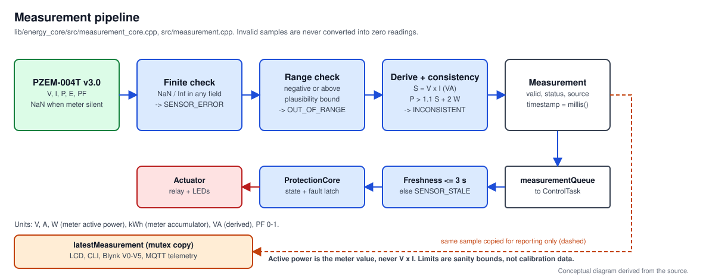

# Measurement Pipeline

## 1. Source selection

The source is chosen **only** by the PlatformIO environment (`src/build_mode.h`):

| Environment | Flag | Source | Relay GPIO |
|---|---|---|---|
| `esp32dev_sim` (default) | `-DENERGY_SOURCE_SIMULATION` | `SIMULATION` | held at OFF level, never ON |
| `esp32dev_pzem` | `-DENERGY_SOURCE_PZEM` | `PZEM` | follows the protection state |

Defining both flags, neither flag, or enabling the relay in a simulation build
is a compile error. Every `Measurement` carries its `source`, and diagnostics,
telemetry (`source`, `simulated`) and the LCD (`S` in column 16) report it.

## 2. Structure and units

`lib/energy_core/src/measurement_types.h`

| Field | Unit | Origin |
|---|---|---|
| `voltage` | V RMS | PZEM `voltage()` |
| `current` | A RMS | PZEM `current()` |
| `power` | W, **active** power | PZEM `power()` (the meter's own measurement) |
| `energy` | kWh | PZEM `energy()` accumulator (the meter counts; the firmware does not integrate or persist it) |
| `apparentPower` | VA | derived: `V x I` |
| `powerFactor` | 0..1 | PZEM `pf()` (simulation: P/S) |
| `valid`, `status` | - | result of validation |
| `timestamp` | ms | `millis()` at read; wraps after ~49.7 days, all comparisons are rollover safe |

`V x I` is apparent power, so it is never used as active power.

## 3. Validation policy (`buildMeasurement`)

1. Any NaN/Inf in V, I, P, E or PF -> `SENSOR_ERROR` (the PZEM driver returns
   NaN when the meter does not answer).
2. Negative values, or values above the plausibility bounds (300 V, 100 A,
   25 kW, 10 000 kWh) or PF outside 0..1 -> `OUT_OF_RANGE`.
3. Active power above `1.10 x S + 2 W` -> `INCONSISTENT` (P cannot exceed S;
   the tolerance absorbs rounding and meter tolerance).
4. Otherwise `OK`.

An invalid result has `valid == false` and **all numeric fields zeroed**.
A zero must always be read together with `valid`; the protection logic never
treats an invalid sample as "0 W". A default-constructed `Measurement` has
status `NOT_INITIALIZED`.

The bounds are sanity limits chosen wider than the commonly published
PZEM-004T v3.0 ranges (80-260 V, 0-100 A with the external CT, about 23 kW,
0-9999.99 kWh). They are **not** calibration data. Check them against your
module's documentation. The consistency tolerance has not been exercised on
hardware; if it produces false faults on your meter, widen
`MeasurementLimits` rather than disabling the check.

## 4. Freshness

`ControlTask` calls `protectionUpdate()` with each sample and
`protectionTick()` otherwise. A sample older than `MAX_MEASUREMENT_AGE_MS`
(3000 ms) or silence for that long latches `SENSOR_STALE`.

## 5. Simulation profile

Repeats every 15 s (`simulationSample`), always labelled `SIMULATION`:

| Time | V | I | P | Expected state |
|---|---:|---:|---:|---|
| 0-5 s | 230 V | 0.20 A | 40 W | NORMAL |
| 5-10 s | 230 V | 2.17 A | 500 W | WARNING |
| 10-15 s | 230 V | 2.60 A | 600 W | WARNING, then FAULT after 2 s |

The simulation exercises the same validation and protection code as the real
source. It does not model sensor noise, comms errors or energy accumulation
(`energy` is always 0). With a latched fault the profile returns to 40 W at
15 s, so a `reset` then succeeds.

## 6. Calibration and accuracy

No calibration coefficients or accuracy figures are applied or claimed. The
README records that the author compared PZEM readings against a trusted
meter; the reference meter, load, conditions and errors were not recorded in
this repository, so the comparison is not reproducible from committed
evidence (see docs/test-procedure.md for the record to create).

## 7. PZEM mode details

- UART2, 9600 baud 8N1; GPIO16 is the ESP32 **RX** (connect to PZEM TX),
  GPIO17 the ESP32 **TX** (connect to PZEM RX).
- The driver rate-limits bus updates (200 ms) and returns NaN on failure.
- Verify logic-level compatibility of your module before connecting it.
- The PZEM is a measurement device, not the protection mechanism.
